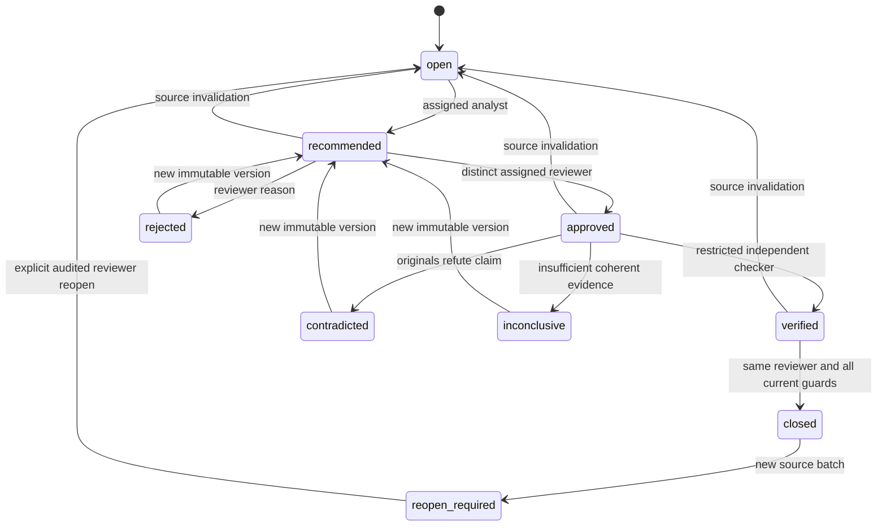

# Reviewed synthetic investigation workflow

Phase 1A-3B extends the [local analyst workspace](ANALYST_WORKSPACE.md). Its only action is `NO_ACTION_AUTHORIZED_EXERCISE`, with `execution_targets=[]`. It records a human recommendation to take no containment or cloud action for a synthetic lab exercise. It implements no executor, remediation, independent AWS source authentication, Wazuh, public hosting or AI integration.

Evidence remains synthetic and unauthenticated at every state, including a `verified` consistency receipt and a closed exercise. Human recommendation text is an assertion; analyst notes cannot independently establish facts. Two accounts controlled by one person simulate separation of duties rather than independent organizational authority.

## State and bindings

The machine pipeline retains its immutable findings, case revisions, `current/pending/superseded/withdrawn` statuses, lineage and `unreviewed=true` draft payloads. Human state lives in separate tables. A human exercise closure never rewrites a machine revision or claims a cloud incident was contained.

Each case has a stable recommendation ID and immutable numbered versions. A recommendation binds authenticated author, exact current case ID/revision/fingerprint, finding and rule/version/digest, correlation identity, event window, exact evidence/hash associations, complete source-manifest fingerprint, generation, workflow epoch and policy `offline-no-action/1`. Rationale, counterevidence and visibility gaps remain authored text. Supporting evidence is selected by the server from the case, not an arbitrary caller-selected URL or path. Database timestamps establish creation and expiry.

Recommendations expire after 30 minutes; reviews cannot outlive their recommendation. Receipt expiry is at most ten minutes and no later than recommendation expiry. These limits govern decision authority at transition time. A retained historical closure is not a statement of continuing visibility or authenticity after that moment.

Each mutation compares the server-managed workflow version, current machine bindings and one-use action-specific CSRF. Review is terminal for that recommendation version; concurrent approve/reject submissions produce one decision. New rationale requires a new recommendation version and a new review. The author cannot approve, and analysts/auditors cannot close. Policy conservatively requires the author to remain an enabled assigned analyst and the approving reviewer to remain enabled, assigned, separately authenticated and distinct. Only that approving reviewer may perform closure. Current verifier mapping, grant and checker pin must still match.

The latest matching verification must be `verified`; selecting an earlier success cannot bypass a later negative result. Rejected, expired, stale, contradictory or inconclusive workflows remain open. All original decision/receipt/closure rows remain immutable. Recommendation history shows at most20 scalar summaries with total/truncation counts; exact versions, including older versions, open individually through an authorized read-only route. A response never repeats the full evidence array for every historical version.

## Source changes and reopening

Every new committed source batch invalidates human authority, including added duplicate delivery provenance that does not advance machine generation. This conservative policy binds the full original/reference snapshot as well as unique normalized events. Exact checkpoint replay adds no batch and remains idempotent.

Ingestion appends an invalidation transition and audit in its existing transaction. A previously closed exercise becomes `reopen_required`; the old closure is retained. After the current generation is published and the case is eligible, an assigned reviewer must explicitly reopen with a reason and fresh CSRF. Unchanged closed cases cannot be reopened to bypass this policy. A new epoch requires new recommendation, review and verification. Superseded parents retain history; a merged successor inherits no case grant, verifier scope, recommendation or closure.

## Authority matrix

| Identity/capability | Reads | Mutations |
| --- | --- | --- |
| Per-account auth / `csl_ws_auth` | Own enabled identity/password/session boundary | Own session lifecycle and action-bound CSRF only |
| Analyst data / `csl_ws_reader`, `csl_ws_notes` | Assigned cases, exact evidence and human history | Notes and bound recommendation versions; no review, verifier receipt or closure |
| Reviewer data / `csl_ws_reader`, `csl_ws_reviews` | Assigned cases, recommendations, queue and history | Distinct review, guarded closure and permitted explicit reopen; no recommendation or machine receipt |
| Auditor data / `csl_ws_reader` | Assigned read-only evidence/workflow history | None |
| Gate / `csl_ws_gate` | Nonsecret schema receipt | Bounded pre-login challenges/throttle only |
| Dedicated verifier LOGIN / `csl_ws_verifier` | One explicitly granted case's verification snapshot and manifest-authorized originals | Begin request and append computed consistency receipt; no account/session, analyst decision, closure or executor authority |
| `csl_ws_owner` | Required machine metadata and human workflow rows | NONLOGIN function/table owner; narrow locking/audit authority, no archive-byte access |
| `csl_vf_owner` | Necessary complete original/source context and current bindings | NONLOGIN verifier-function owner with enumerated request/receipt/locking/audit authority; unavailable to web logins |
| Collector LOGIN / database-scoped `csl_pc_<database_hash>` | Required original/source/checkpoint metadata and bounded machine status | Append validated originals, deliveries, checkpoints, quarantine and queued detection work; no machine publication or human authority |
| Worker LOGIN / database-scoped `csl_pw_<database_hash>` | Required original/source/machine state; no human tables or audit payloads | Leased jobs, findings, machine revisions/lineage and local test outbox; no original replacement or human decisions/receipts |
| Offline maintenance | Explicit isolated owner authority | Migration, provisioning, grants, disabling and recovery; never normal collector/worker/verifier/web credentials |

Runtime logins are NOSUPERUSER/NOCREATEDB/NOCREATEROLE/NOREPLICATION/NOBYPASSRLS, own no persistent objects and receive only their exact capability memberships without ADMIN option. Named functions derive identity from `SESSION_USER`, not JSON fields. Human and verifier identities cannot directly edit immutable evidence, findings, jobs, decisions, receipts, closures or audit, and cannot assume owner/other capabilities. Actual restricted SQL denials are acceptance evidence.

Collector and worker receive justified machine-table/column grants, not unrestricted database ownership. They cannot read `ws_*` data or `audit`, directly insert audit rows, execute human/verifier functions, change original evidence or acquire CREATE/owner privileges. A named machine-audit helper fixes the permitted event kinds and binds the actual runtime identity. The source-batch invalidation trigger retains its narrow security-definer authority without granting a collector direct workflow writes. Normal CLI commands validate the actual mapped SQL principal and catalog; selecting maintenance requires the explicit operator flag.

Direct table grants and CONNECT use capabilities scoped to the persisted database UUID. A global shared capability would let a stolen pipeline LOGIN bypass Python checks and query another dataset directly; it is not used. Different dataset UUIDs deny connection at PostgreSQL itself. A protected same-UUID restore intentionally reconstructs the original capabilities and ACL fingerprint.

Database statement triggers enforce the pipeline protocol even for direct SQL using an individual collector/worker credential. Collector source writes require a batch inserted in that same transaction, proved by a server-written full-transaction-ID, server-start-epoch and actor marker in `ws_pipeline_batches`; callers cannot write the marker. The start epoch prevents an old restored marker from authorizing a coincident transaction ID on another server instance. Batch invalidation and source changes commit together. Material worker changes lock the pipeline before row locks and atomically invalidate established human authority, including making a closed exercise require reopening. A custom connection flag or transaction setting cannot substitute for this proof. Job claims acquire pipeline before job locks; unrelated outbox delivery does not confer human authority. These are local transaction controls under a trusted server clock/admin, not source authentication or cross-host recovery support. See PostgreSQL's [transaction identifier semantics](https://www.postgresql.org/docs/17/transaction-id.html).

Security-definer functions pin `search_path=pg_catalog,csl,pg_temp`, qualify object references and revoke PUBLIC execution. Both function owners' global function defaults suppress PUBLIC EXECUTE; maintenance-created functions receive explicit restrictions in the migration transaction. Restored ACLs and owner/signature/default privilege state must match the original receipt. Runtime catalog checks also reject unintended non-system object authority.

## Independent verifier methodology

The verifier is a separate process with a private `{dsn, verifier_id, case_id}` configuration. It has no human credentials, maintenance DSN or HTTP verdict endpoint. Its command accepts only configuration and bounded recommendation/version/run references. It does not accept a verified flag, replacement evidence, URL, shell command, trust label or execution targets.

The database pins a case-bound request to the current approved recommendation and full bounded dataset manifest. Complete context matters: an omitted original could extend or bridge the component, and the detector suppresses all findings if any complete-record identity conflict exists. A verifier grant therefore permits the complete synthetic dataset snapshot **only through that case-bound request**, not general table reads or an arbitrary archive browser. Full gzip archives may contain other case records. Web readers retain their narrower exact-record boundary.

The service fetches one authorized original at a time and independently recalculates exact compressed/expanded hashes, canonical complete records, identities, delivered record membership, normalized claims and full evidence bindings. The public importer supplies shared hostile-gzip/JSON syntax/resource validation; its normalized identity/session decisions and hashes are not proof. The checker has its own canonicalization, raw-field qualification, session consistency, window grouping and finding/case binding logic. This shared syntactic boundary is an explicit limitation, not a claim of independent parser implementation.

For each complete credential session, the checker sorts qualifying unique events and unions every consecutive triple spanning at most an inclusive 60 seconds. The connected components exactly recover overlapping qualifying windows, including components spanning over60 seconds. It compares the entire ordered evidence component and exact count, session, window, rule and fingerprints, not just an arbitrary matching triple. Duplicate delivery counts once; full-record conflicts, including unknown fields, fail closed. Null successful response fields are permitted, present AWS error fields are not.

Verdicts have narrow meanings:

- `verified`: all complete-original, integrity, scope, membership, semantic and current binding checks pass.
- `contradicted`: coherent intact originals refute the relevant semantic claim or exact component.
- `inconclusive`: evidence is missing, malformed, corrupt, unsupported, incomplete or unavailable as a coherent scope.

Stale finalization is rejected rather than promoted to a current receipt. Every receipt records checker version, definition digest, installed source digest, exact request/bindings, check results, scope, time, expiry and limitations. The installed checker source bytes are pinned when maintenance provisions the verifier; changing code requires explicit new reviewed checker authority. Retries with the same run reference recover the same committed receipt; conflicting replay fails.

A verified burst can be benign inventory, pagination or retries. Verification does not establish malicious activity, the real-world authorization of an exercise, authentic AWS telemetry or absence of unseen events. The service implementation, credential custody and host remain trusted. A compromised verifier credential or database administrator is not remotely attested by these local hashes.

Separate SQL credentials and files demonstrate database authority separation, not operating-system process isolation. This lab runs under the operator's local account; code execution as that account can read its private service files. Separate OS-account custody or host isolation has not been implemented or demonstrated. A full web-process/host compromise must therefore not be represented as contained by the SQL role model.

## Transactions, migration and recovery

Mutation lock order starts with pipeline, current-generation job SHARE, case and workflow, matching worker publication's pipeline-before-job/case serialization. The current job must exist and have succeeded; equal generation counters alone do not authorize closure while that job is queued, leased, retryable, dead or superseded. Older-generation work does not invalidate a fully published current generation. Current principal/session/grant and bound author/reviewer/verifier rows are locked and rechecked before decisions; current roles/mappings must not come from a pre-wait snapshot. Closure repeats all freshness checks after relevant locks. No new path obtains pipeline after already holding a case row. Audit insertion, domain mutation, nonce/request consumption and transition commit together.

Migration003 adds twelve tables: `ws_workflows`, `ws_recommendations`, `ws_reviews`, `ws_verifiers`, `ws_verifier_grants`, `ws_verification_requests`, `ws_verifications`, `ws_closures`, `ws_transitions`, `ws_workflow_csrf`, `ws_pipeline_identities`, `ws_pipeline_batches`. All 29 prior tables and original ledger rows remain, for41total. Migrations001/002 and the v2 database UUID remain unchanged. The v3 receipt extends security/default-owner coverage while retaining prior-version validation algorithms; restore never rebaselines a stored hash.

The no-owner/no-ACL restore target must revoke PUBLIC CONNECT before loading objects and keep both web and verifier disconnected until trusted security reconstruction and original-fingerprint comparison commit. Dumps do not recreate cluster identities/private credentials. Same-cluster fresh/upgrade/restore, real SQL denials, transaction interruption and replay tests are separate from untested cross-host disaster recovery or host power-loss claims. Legacy NUL-containing bytea is retained; current replay remains accurately incompatible and never rewrites evidence.

See [operations](../REVIEWED_WORKFLOW_OPERATIONS.md), [recovery](../FAILURE_AND_RECOVERY.md), [threat model](THREAT_MODEL.md), [interview lab](../labs/PHASE1A3B_INTERVIEW_LAB.md) and [delivery roadmap](../DELIVERY_ROADMAP.md). Phase1B readiness still requires separately authorized authenticity/live-source, SIEM/hardware, cost, IAM and operational gates.
