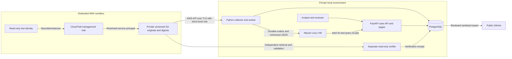

# System design

Status: proposed architecture, 2026-11-03. Nothing described as a runtime capability is implemented here. Read with the [reuse audit](REUSE_AUDIT.md), [threat model](THREAT_MODEL.md), [cost plan](CLOUD_COST_AND_SAFETY.md), and [delivery gates](../DELIVERY_ROADMAP.md).

## Intent and scope

Build an AWS-first portfolio that makes security decisions reproducible and teachable. The unit of value is a closed investigation with inspectable evidence and justified limits. Separate software tests, authentic lab observations and operational security outcomes.

Start with one dedicated sandbox account, one explicit region (`us-east-1` proposed), one operator, and a local application. No production accounts, external targets, credential collection, malware, autonomous changes, public application hosting or high-availability claims. Enterprise practices inform the boundaries; the lab is not an enterprise deployment or production SOC.

## Alternatives and decisions

These are architect recommendations, not owner-approved implementation commitments.

| Choice | Alternatives | Recommendation and reason |
| --- | --- | --- |
| Application | Python modular application; ingestion/detection/case microservices | One Python package and database. API and worker run as separate processes for privilege separation. PostgreSQL-backed jobs avoid Redis/Celery initially. |
| API/schema | FastAPI/Pydantic; hand-written HTTP; TypeScript backend | FastAPI with strict models and server-side authorization. Existing validation patterns help; validation is not authentication. No graph database is needed for bounded event relationships. |
| Persistence | PostgreSQL; JSON/SQLite; managed database | Local PostgreSQL, migrations, transactional constraints, jobs and backup/restore tests. Artifact files alone cannot safely handle approval races. No RDS for the first slice. |
| Analyst UI | Server-rendered pages; Next.js; SIEM alone | Small FastAPI-served case workspace. Existing Next.js implementations demonstrate UI feasibility, but a second runtime adds work before case workflows exist. Reconsider after Phase 2. |
| SIEM | Wazuh; Elastic Security; Sentinel; managed OpenSearch | Select local Wazuh. It provides real alert analysis without AWS hosting charges. Allocate a Linux VM with 4 vCPU, 8 GiB RAM and 50 GB storage for the smallest documented quickstart tier. This is a gate, not a claim about available hardware. Elastic adds maintenance; Sentinel adds Azure identity/ingestion cost; OpenSearch alone is not a complete SIEM. No rented fallback is approved. |
| Transport | CloudTrail → S3 polling; EventBridge/SQS; event history | Trail-backed originals plus digest validation are authoritative. Polling avoids extra services. Queue messages may later be notification hints, never source authentication. Event history is a read-only verification aid, not a signed archive. |
| IaC | Terraform; console; CloudFormation | Terraform for reviewed plans and teardown. Neither infrastructure source repo supplies a usable Terraform foundation. Bootstrap privileges still require separate review. |
| AI | None; hosted/local model | None on the critical path. Optional assistance follows deterministic workflow/evaluation gates. Zero autonomous production-security actions in every phase. |

Wazuh sizing and collection are grounded in its [quickstart](https://documentation.wazuh.com/current/quickstart.html) and [file collection documentation](https://documentation.wazuh.com/current/user-manual/capabilities/log-data-collection/monitoring-log-files.html). Pin a supported stable release and matching configuration format during implementation; no installed version or compatibility is claimed here.

## Deployment and trust boundaries

1. **AWS control plane:** provisioner handles named lab resources. Collector, test actor and verifier cannot provision or mutate them. Runtime confirms the expected account and principal through STS and rejects unexpected scope before reads.
2. **Source to evidence:** check object owner, prefix, trail and signed-digest membership independently of JSON fields. `userIdentity` describes the event actor; it does not authenticate delivery.
3. **Raw to normalized:** parsing is a hostile-input boundary. Original compressed objects remain untouched. Normalization is a versioned derivative pointing to the object and record index.
4. **Application to SIEM:** Wazuh is a searchable derivative store. It receives neither AWS credentials nor unrestricted raw exports. Active response is disabled; SIEM alerts never authorize actions.
5. **User to API:** authenticated identities and server-side roles govern reads, recommendations, review and closure. Client role labels are not authorization.
6. **Application to verifier:** separate read-only credentials and separately implemented checks. The verifier cannot create execution receipts. Shared host administration remains a compromise risk.
7. **Private to public:** reviewed sanitized summaries only. Redacted exports cannot prove byte equivalence to raw evidence; a private manifest connects exports to originals.

## First complete vertical slice

The following is a proposed test, not an executed result.

1. After Phase 1 cloud authorization, create the trail/archive with a reviewed Terraform plan and private baseline inventory. Enable management **read/write** events and integrity validation; disable data events and Insights.
2. A dedicated test role makes three successful, single-page `ec2:DescribeInstances` calls within 60 seconds in the allowed region. An empty account works: no instance or attack tool is necessary. Record an exercise window/run ID privately. A nonsecret SDK user-agent hint may aid correlation, but cannot authenticate origin.
3. Collector polls approved log/digest prefixes every five minutes, paginates fully, and records exact version/length and compressed-byte SHA-256 before parsing. Overlapping listing windows and a daily bounded reconciliation of retained prefixes recover late files and crashes.
4. Await a signed digest covering each exact file. Use supported AWS validation tooling against original S3 locations. Save tool version, interval, exact file membership and results; bind downloaded hashes to the validated files. A successful exit or empty interval is insufficient. Missing/invalid digest blocks trusted findings and closure.
5. Normalize authentic records and run the deterministic inventory-burst rule. Create one finding/case from the three unique events. This is an informational lab hypothesis, not a compromise verdict.
6. Send minimized normalized events and Python findings through a durable outbox to a local Wazuh agent/file collector. Verify authenticated transport, decoder fields, custom rule, persisted alert and index query. Case and SIEM share event/finding IDs; synthetic replay remains a separate source class.
7. Analyst reviews source references, actor/session, timeline, exercise record, gaps and false positives. Recommend `NO_ACTION_AUTHORIZED_EXERCISE` with evidence and an explicit statement that containment was neither required nor performed.
8. A distinct authenticated reviewer approves the exact recommendation. A separately run verifier retrieves originals/digests, checks the three calls with an independent simple predicate, reviews test-role permissions, and checks the bounded interval for visible unexpected writes. Result is `verified`, `contradicted` or `inconclusive` with visibility limits. This cannot prove absence of all malicious activity.
9. Close only when review/verification match current evidence and recommendation versions. A sanitized report labels actual AWS lab telemetry, synthetic failure tests and proposed later capabilities separately.

CloudTrail's [signed digest mechanism](https://docs.aws.amazon.com/awscloudtrail/latest/userguide/cloudtrail-log-file-validation-intro.html) and [CLI validation rules](https://docs.aws.amazon.com/awscloudtrail/latest/userguide/cloudtrail-log-file-validation-cli.html) require explicit original-file validation, not merely enabling the setting. The live acceptance window allows up to 24 hours for delivery/digests with pending status; this is a test timeout, not a service guarantee. Stop and investigate at that bound; do not replace missing live evidence with fixtures.

### Exact-file validation binding

Maintain two separate SHA-256 fields: `archive_sha256` over downloaded gzip bytes (preservation/retrieval consistency), and `content_sha256` over the exact decompressed log bytes before parsing (digest-member comparison). Do not reserialize JSON for this comparison. AWS specifies [uncompressed content for the digest hash](https://docs.aws.amazon.com/awscloudtrail/latest/userguide/cloudtrail-log-file-custom-validation.html); a digest does not directly authenticate gzip headers or compression choices.

For Phase 1, use supported CLI validation on original S3 locations, not a custom cryptographic implementation. Capture current log/digest version IDs and digest signature metadata before validation, download those exact versions, validate the covering original-location chain, then re-read current version metadata. Require unchanged versions across that interval, explicit successful membership for every target log, and `content_sha256` equality with its entry in that successfully validated digest. Store the compressed preservation hash alongside that result. A replaced/missing version, unrelated digest, empty validation or ambiguous CLI output fails closed; do not validate one current object and attach the result to an older cached version. Include backfill digests and the chain's start/gaps in the receipt. This continuity protocol is a proposed acceptance requirement and needs live/negative tests; it does not make administrator-controlled storage immutable.

## Data and evidence contracts

Use UUIDs, UTC timestamps, bounded strings, strict enums, explicit unknown/null semantics and immutable schema versions. Private account/principal/resource values never appear in public examples; use named placeholders.

| Entity | Required fields/invariants |
| --- | --- |
| `CollectionRun` | Run ID, source mode, collector version, expected identity reference, interval, pagination/reconciliation counts, errors, visibility. |
| `RawObject` | Private bucket/key/version and original location, expected owner/trail, `archive_sha256`, `content_sha256`, lengths, fetched time, exact digest version/signature metadata, validation interval/membership/status and before/after version-continuity receipt. ETag is not a content hash. |
| `Event` | Source mode, recipient account, region, event ID/time, receive time, record index, raw reference, normalized actor/session/resource/action/outcome, parser version. JSON identity is untrusted until provenance passes. |
| `Finding` | Rule ID/version/code hash, window, ordered evidence, correlation key, ATT&CK/rationale, false positives, trust level and limits. |
| `Case` | Evidence/finding references, append-only timeline, hypotheses/counterevidence, disposition, acknowledged gaps, version/status. |
| `Recommendation` | Case version, action enum, exact targets, evidence hash, preconditions, policy version, expiry, reason/author. No arbitrary commands/URLs. |
| `Approval` | Authenticated distinct reviewer, exact recommendation hash/version, time/expiry/decision. Material evidence/target/policy/precondition changes invalidate it. |
| `ExecutionAttempt` | Later only: approval, idempotency key, actor, precondition reads, request/result metadata, times, `succeeded/failed/unknown`. Success is not remediation proof. |
| `Verification` | Independent identity/checker version, exact case/recommendation/attempt, fresh reads, expected/observed state, visibility/result. No-action has no execution attempt. |
| `AuditEntry` / `Outbox` | Actor, object/version, event/time, previous hash/sequence; payload hash, attempts/lease/acknowledgment. Append-only application access is not administrator-proof immutability. |

Preserve originals in versioned S3 and a bounded private cache; back up database receipts. Versioning provides recovery, not WORM. Object Lock is deferred because retention obstructs teardown. A validated digest does not establish that every possible AWS activity was logged.

## Ingestion, deduplication and errors

- Proposed limits: 10 MiB compressed, 100 MiB expanded, 10,000 records/object, bounded nesting/strings, 2 GiB cache. Malformed, oversized or unsupported files enter private quarantine with reason; no untracked partial acceptance.
- Unique identity: `(source_mode, recipient_account, aws_region, event_id)`. Duplicate deliveries link to one event. Same identity with conflicting content creates a conflict and blocks trust, never silent overwrite. Retain every raw delivery reference.
- Define duplicate content using a versioned canonical representation of the **complete source record before normalization**, including unknown fields: sorted object keys, unchanged string values, ordered arrays, explicit types and one pinned finite-number encoding. Reject duplicate JSON keys and nonstandard numeric constants before canonicalization. Hash that representation separately from file hashes. Same record in a different gzip file is a duplicate, not a conflict; differing source content discarded by the normalizer still conflicts. Parser/canonicalization upgrades create new derivatives, retain prior records, and require explicit migration/recomparison rather than redefining identity silently.
- Commit events/findings/cases/outbox transactionally. Leases, uniqueness and idempotency make retries safe. Advance checkpoint only after a durable transaction.
- Bounded jitter/backoff for timeouts/throttles, then retryable/dead-letter state. Wrong owner, access denial, signature failure and source mismatch fail closed. Errors never become fabricated empty results.
- Monitor collected/rejected/pending/verified/duplicate/conflict counts, pending-digest age, collection lag, disk, job retries and SIEM acknowledgment lag. At 80% cache or unexpected cost/volume, pause safely and retain work. Cases show blind intervals.

## Detection and correlation contract

Rule `AWS-LAB-001` matches successful management events with `eventSource=ec2.amazonaws.com`, `eventName=DescribeInstances`, `readOnly=true`, expected account/region and valid assumed-role session identity. Count **three unique event IDs in an inclusive 60-second event-time window**, keyed by account, region, session issuer and session identifier. Never join unrelated sessions by display name.

For this rule, require `eventCategory=Management`, `eventType=AwsApiCall`, no AWS `errorCode`/`errorMessage`, and a valid `AssumedRole` identity. Null `responseElements` is permitted for a read-only call; it is not a failure indicator. Source/type errors are nonqualifying with explicit reason. AWS documents [EC2 management-event capture](https://docs.aws.amazon.com/AWSEC2/latest/UserGuide/monitor-with-cloudtrail.html).

The exact private credential-session key is `(recipientAccountId, awsRegion, sessionIssuer.arn, userIdentity.accessKeyId, sessionContext.attributes.creationDate)`, with principal ID/assumed-role ARN checked for consistency. Require nonempty access-key identity and valid issuance time; missing/ambiguous identity is nonqualifying/unknown. A role ARN, principal ID or session name alone can be reused and is insufficient. Preserve these [CloudTrail identity fields](https://docs.aws.amazon.com/awscloudtrail/latest/userguide/cloudtrail-event-reference-user-identity.html) privately, never publish access-key identifiers, and test two distinct credential sessions using the same role/session name.

Sort by event time then ID. Derive finding identity from rule version, correlation key and ordered evidence IDs. Overlapping windows sharing events merge into one case within the bounded exercise; disjoint qualifying windows create separate findings. A finite exercise interval plus 24-hour reconciliation bounds Phase 1. Late arrivals append a revised case and invalidate stale review.

Map to [T1580, Cloud Infrastructure Discovery](https://attack.mitre.org/techniques/T1580/): the API enumerates infrastructure. Do not call it object discovery, credential abuse or a validated attack. Administrators, inventory tools, pagination and SDK retries generate benign bursts. Single-page exercise calls reduce ambiguity; tests cover it. Fixture metrics and lab timing demonstrate mechanics, not field precision/recall.

## API and analyst workflow

Proposed reads: `GET /cases`, `/cases/{id}`, `/cases/{id}/timeline`, `/evidence/{id}` (authorized metadata/download), `/findings/{id}`, `/health` (minimal). Writes: `POST /cases/{id}/notes`, `/recommendations`, `/recommendations/{id}/reviews`, `/cases/{id}/verifications`, `/cases/{id}/close`. No generic upload or command execution route. Synthetic import is an explicit offline CLI mode that cannot assign trusted-source status.

Bind to loopback. Use a maintained authentication implementation with individually provisioned local users, strong password hashing, expiring server-side sessions, secure/HttpOnly/SameSite cookies, CSRF/origin checks and local TLS. Roles: analyst, reviewer, read-only auditor, plus separate worker/verifier identities. No shared/default passwords or browser AWS credentials. Enforce object authorization server-side; mutations require a version/If-Match precondition and transactional audit entry. No self-approval. Add bounded pagination, rate limits, escaped output, parameterized queries and restrictive security headers. External OIDC/public hosting require later review. Unknown routes and health probes must not consume investigation/provider budgets.

States: `open → triaged → recommendation_pending → reviewed → verification_pending → closed`. Rejection returns to triage; stale evidence invalidates review; failed/inconclusive verification keeps the case open. Later actions insert `execution_pending → attempted` before verification. Never close from an API 200. Two local users owned by one person demonstrate workflow separation, not independent organizational authority; record that limitation.

| Principal | Permitted writes | Forbidden authority |
| --- | --- | --- |
| Analyst | Notes and recommendations on authorized cases | Approval, machine verification receipts, changing source trust |
| Reviewer | Exact current reviews and closure requests after gate checks | Self-approval, machine verification receipts, granting service roles |
| Verifier service | Only its own version-bound machine verification receipts, with raw-observation references and checker/source revision | Notes/reviews, execution receipts, changing evidence or own privileges |
| Collector/worker | Assigned evidence/job/finding/outbox operations | Reviews, machine verification receipts, cloud-changing actions |
| Auditor | None | All mutations |

Only the verifier service principal may call the verification-write route. Bind that identity server-side; do not accept a JSON `verifier` field as authority. Give processes distinct restricted database roles (or route narrow writes through authorized service methods); no shared unrestricted DB credentials. Receipt validation requires exact case/evidence versions, checker version and fresh raw-observation references. Analysts/reviewers cannot create `verified` results or self-grant verifier access. Test direct unauthorized route/database writes as well as UI flows.

## Later capabilities and dependencies

- **Assessment:** read-only S3 public-access/encryption/versioning and bounded IAM checks, linked to timestamped snapshots. Add repository/container vulnerability scans with tool/database versions, SBOM and expiring exceptions. A scanner finding alone is not proof of exploitability; errors are unknown, not pass.
- **Response:** after Phase 2 gates, permit only setting all four bucket public-access-block flags to true on one exact non-logging marker bucket. Account-level blocking stays enabled. Require human approval, fresh preconditions and independent state reads. No IAM edits, deletes, arbitrary shells or rollback that weakens controls. Exact-resource IAM limits the bucket/action, but does not enforce the four Boolean payload values; that restriction is application policy. A compromised responder could clear bucket-level flags, so its inability to modify account-level blocking is essential defense in depth, not proof that the responder is harmless.
- **CI/CD:** pinned locks/actions, secret scanning, lint/types/tests, dependency/SBOM/container scans, Terraform formatting/validation and static IAM checks. PR jobs have no AWS credentials. Later OIDC must restrict repository/ref/environment; forks/untrusted PRs cannot deploy. Apply always needs separate authorization.
- **AI:** optional sanitized/bounded inputs; schema-constrained claims with existing evidence IDs, explicit unknowns and deterministic citation checks. Logs/retrieved text are untrusted prompt-injection content. No tools, credentials or approval/execution authority. Record model/prompt versions; test adversarial inputs and unsupported claims. Investigation works with AI absent.

## Dependency and operational policy

The later bucket-block permission also authorizes removal of that bucket's block configuration. The action adapter forbids removal; IAM does not distinguish it with a separate delete permission. The responder cannot alter account-level blocking. See the [access-boundary caveat](CLOUD_COST_AND_SAFETY.md#access-boundaries) before designing or approving that role.

Pin Python, PostgreSQL, FastAPI/Pydantic, Terraform/provider and Wazuh at the implementing milestone after compatibility/security review. Use locks and reviewed updates. No number here implies an installed version. Kubernetes, Kafka, graph storage, Redis, managed search and hosted LLMs add no necessary value to the first slice.

A second operator must reproduce offline tests, restore a private backup, run the documented authorized AWS exercise, inspect SIEM receipts and complete the [mastery assessment](../INTERVIEW_MASTERY.md) before claiming independent reproducibility. Hardware, credentials, pricing and teardown are Phase 1 gates, not verified facts of this design.
